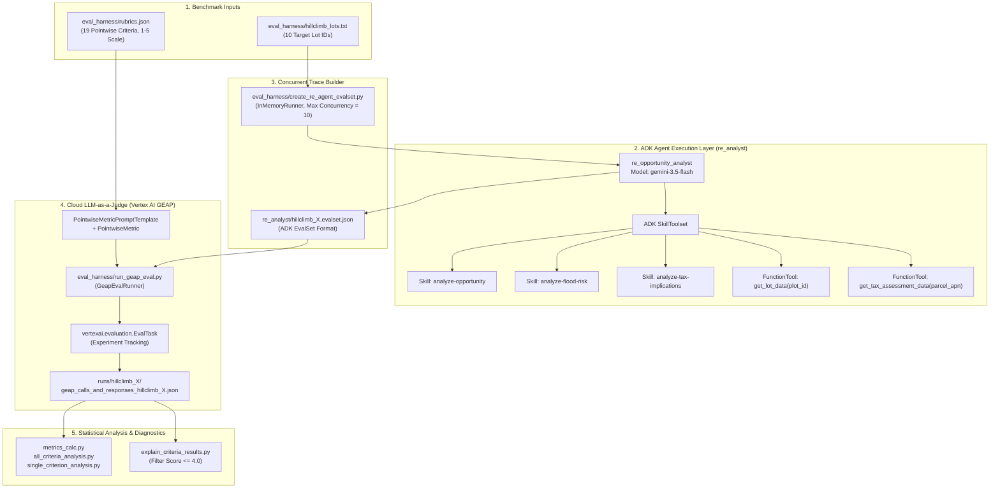

# Technical Design Document: Evaluating and Hill Climbing a Gen AI Agent using Autoraters

## 1. Executive Summary & Problem Statement

When prototyping domain-specific Generative AI agents—such as the **Real Estate Investment Opportunity Analysis Agent (`re_analyst`)**—engineering teams frequently collaborate with subject-matter experts (real estate analysts) who can articulate evaluation rubrics (`eval_harness/rubrics.json`) but lack the time to label hundreds of golden reference reports for human-vs-LLM judge calibration.

To iterate rapidly and scientifically without human ground-truth labels, this system implements a two-phase methodology:
1. **Autorater Self-Consistency (Intra-Rater Reliability) Screening**: Run stochastic multi-pass ($k=15$) LLM-as-a-Judge evaluations across a corpus of $N=32$ agent reports and apply inter-/intra-rater reliability statistics (**Krippendorff's Alpha**, **Pairwise Percent Agreement**, and **Report Score Variance**) to separate reliable, well-specified rubric criteria from vague or degenerate criteria.
2. **Automated Agent Hill Climbing**: Target specific programmatic deficiencies identified by the rubric (`cost-per-acre` and `neighboring-flood-risk`) and iteratively refine the agent's modular **ADK Skills (`SKILL.md`)** until the agent achieves $> 4.0$ mean scores across all benchmark properties.

---

## 2. System Architecture



---

## 3. Component Design

### 3.1. ADK Agent & SkillToolset (`re_analyst/`)
The agent (`re_opportunity_analyst` in `re_analyst/agent.py`) is built using the Google Agent Development Kit (ADK) and powered by `gemini-3.5-flash` via Vertex AI.

- **System Instruction**: Enforces a standardized 5-section memorandum structure:
  1. `## Executive Summary`
  2. `## Acquisition Basis and Holding Costs`
  3. `## Zoning and Infrastructure Readiness`
  4. `## Risk Assessment`
  5. `## Recommendation`
- **Tools (`re_analyst/tools/`)**:
  - `get_lot_data(plot_id: str)`: Queries `tools_data/lots_database.json` and returns `plot_id`, `parcel_apn`, `acreage`, `zoning`, `last_sale_price`, `last_sale_date`, `flood_zone`, `soil_classification`, `topography`, `utility_access`, `easement_type`, `environmental_status`, and **`adjacent_parcels`** (list of neighboring Lot IDs).
  - `get_tax_assessment_data(parcel_apn: str)`: Queries `tools_data/tax_database.json` and returns `assessed_land_value`, `assessed_improvement_value`, `total_assessed_value`, `annual_tax_amount`, `millage_rate`, `tax_delinquency_status`, and `special_assessments`.
- **Skills (`re_analyst/skills/`)**:
  - Loaded dynamically via `load_skill_from_dir` into a `SkillToolset`:
    - `analyze-opportunity`: Orchestrates end-to-end parcel due diligence, adjacent lot lookup, and core valuation calculations.
    - `analyze-flood-risk`: Governs FEMA flood zone flagging, structural/insurance implications, neighboring parcel hydrological/runoff analysis, and Phase I/II ESA due diligence.
    - `analyze-tax-implications`: Governs property tax carrying cost derivations (`Annual Tax / 12`) and acquisition basis benchmarking (`Last Sale Price / Acreage` vs. `Assessed Land Value / Acreage`).

### 3.2. Concurrent Trace Generation (`eval_harness/create_re_agent_evalset.py`)
- Executes `re_analyst` concurrently across target Lot IDs using `asyncio.Semaphore(10)` and `google.adk.runners.InMemoryRunner`.
- Captures the full multi-turn tool-invocation trajectory (`intermediateData.toolUses` and `intermediateData.toolResponses`) along with the final markdown report (`finalResponse`), serializing them into an ADK-compliant `.evalset.json` file inspectable via `adk web`.

### 3.3. Vertex AI Gen AI Evaluation Service Bridge (`eval_harness/run_geap_eval.py`)
- **Rubric Normalization**: Maps each entry in `eval_harness/rubrics.json` (`criterion_id`, `name`, `criterion`, `rating_scale`) into a Vertex AI `PointwiseMetricPromptTemplate` and wraps it in a `PointwiseMetric`.
- **Majority-Voting Behavior**: By default, the Vertex AI Gen AI Evaluation Service samples the judge model 4 times internally per pass and takes a majority vote (`judge_model_sampling_count`), which slightly inflates raw agreement metrics and requires conservative thresholds when interpreting Krippendorff's Alpha.
- **Dry-Run vs. Live Execution**:
  - `--dry-run`: Renders the exact judge prompt on-the-fly (`template.assemble(response=...)`) and writes `is_dry_run: true` without invoking cloud APIs.
  - Live mode: Dispatches $k$ `EvalTask.evaluate()` passes to Vertex AI, logs runs under a timestamped Vertex AI Experiment, and records per-pass scores (`1.0`–`5.0`) and textual explanations.

---

## 4. Statistical Design: Autorater Intra-Rater Reliability Analysis

### 4.1. Useful Metrics vs. Distractors
In `single_criterion_analysis.py` and `all_criteria_analysis.py`, 9 summary metrics are computed across the $N \times k$ rating matrix ($N=32$ reports, $k=15$ passes). Crucially, **not all metrics measure rater reliability**:

| Metric | Role in Reliability Analysis | Interpretation |
| :--- | :--- | :--- |
| **`alpha` (Krippendorff's Alpha)** | **Primary Reliability Metric** | Chance-corrected global reliability coefficient ($\alpha \in [-1, 1]$). Accounts for both within-report consistency and between-report variation. Look for $\alpha > 0.80$ (ideally $\ge 0.89$ given 4-vote aggregation). |
| **`sd_report_means` (StdDev of Report Means)** | **Homogeneity Trap Detector** | Measures whether the rubric actually differentiates between reports. If `sd_report_means == 0` (or near 0), all reports received the exact same score. |
| **`perc_agree` (Mean Pairwise % Agreement)** | **Secondary Consistency Metric** | Percentage of pass pairs on the same report that gave the exact same score. Vulnerable to the **homogeneity trap** if used without `sd_report_means`. |
| **`max_range_report` (Widest Range Single Report)** | **Worst-Case Instability Indicator** | Largest `max - min` score spread observed for a single report across the $k$ passes. Values $\le 1$ indicate tight pass-to-pass stability; values $\ge 3$ indicate severe ambiguity on edge cases. |
| **`mean`, `min`, `max`** | **Descriptive Distribution Context** | Useful only for spotting ceiling (`min=5, max=5`) or floor (`mean=1.03`) clustering. |
| **`max_range_pass` (Widest Range Single Pass)** | **Distractor** | Measures score spread across different reports within a single pass—reflects dataset diversity, not rater consistency. |
| **`sd_pass_means` (StdDev of Pass Means)** | **Distractor** | Measures whether whole evaluation passes shifted up or down on average; cancels out opposing errors on individual reports. |

### 4.2. The Homogeneity Trap in the 32-Lot Analysis Dataset
Running `all_criteria_analysis.py` on `runs/geap_calls_and_responses_for_analysis.json` reveals classic homogeneity traps:

```text
criterion_id           |   mean | min | max | max_range_report      | max_range_pass | sd_report_means | sd_pass_means | perc_agree |  alpha
-------------------------------------------------------------------------------------------------------------------------------------------
general-tone           | 5.0000 |   5 |   5 | 0 (LOT-1007 (+31))    | 0 (p1 (+14))   |          0.0000 |        0.0000 |    100.00% |  1.000
logical-flow           | 5.0000 |   5 |   5 | 0 (LOT-1007 (+31))    | 0 (p1 (+14))   |          0.0000 |        0.0000 |    100.00% |  1.000
professionalism        | 5.0000 |   5 |   5 | 0 (LOT-1007 (+31))    | 0 (p1 (+14))   |          0.0000 |        0.0000 |    100.00% |  1.000
readability            | 5.0000 |   5 |   5 | 0 (LOT-1007 (+31))    | 0 (p1 (+14))   |          0.0000 |        0.0000 |    100.00% |  1.000
neighboring-flood-risk | 1.0316 |   1 |   2 | 0 (LOT-1007 (+31))    | 1 (p1 (+14))   |          0.1768 |        0.0000 |    100.00% |  1.000
monthly-tax-holding    | 2.2833 |   2 |   5 | 1 (LOT-1022 (+1))     | 3 (p1 (+14))   |          0.8872 |        0.0110 |     99.17% |  0.997
flood-zone-flagging    | 3.1065 |   2 |   4 | 1 (LOT-1008 (+6))     | 2 (p1 (+14))   |          0.3357 |        0.0258 |     94.41% |  0.897
environmental-esa      | 3.6004 |   3 |   5 | 3 (LOT-1012 (+4))     | 2 (p1 (+14))   |          0.7042 |        0.0566 |     79.10% |  0.897
data-density           | 4.9979 |   4 |   5 | 1 (LOT-1019)          | 1 (p3)         |          0.0118 |        0.0172 |     99.58% |  0.499
professional-tone      | 4.9958 |   4 |   5 | 1 (LOT-1019 (+1))     | 1 (p8 (+1))    |          0.0164 |        0.0229 |     99.17% |  0.498
```

1. **Top Homogeneity Trap (`general-tone`, `logical-flow`, `professionalism`, `readability`)**: Every single pass on every single report gave a `5` (`sd_report_means = 0.0000`). The `krippendorff` library returns `1.000` by convention when observed disagreement is zero, even though expected disagreement is also zero. Similarly, `data-density` and `professional-tone` have $>99\%$ pairwise agreement because 479/480 ratings are `5`, causing Krippendorff's Alpha to drop to `~0.498` once a single `4` appears.
2. **Bottom Homogeneity Trap (`neighboring-flood-risk`)**: In the baseline agent, 31 out of 32 lots omitted neighboring flood zones entirely (scoring `1`), and 1 lot scored `2` (`mean = 1.0316`, `sd_report_means = 0.1768`). Because the upper levels (`3, 4, 5`) of the rubric scale were never exercised in the baseline corpus, its `1.000` alpha does not validate reliability across the full rating scale.
3. **Truly Reliable Criteria (`monthly-tax-holding`, `flood-zone-flagging`, `environmental-esa`)**: These three criteria combine high chance-corrected agreement ($\alpha \in [0.897, 0.997]$) with substantial variation across reports (`sd_report_means` between `0.3357` and `0.8872`), proving the judge consistently distinguishes low-, medium-, and high-quality reports.

---

## 5. Hill-Climbing Optimization Design

### 5.1. Root-Cause Diagnosis of Baseline Failures
1. **`cost-per-acre` (Baseline Score $\approx 1.0 - 2.0$)**:
   - **Rubric Requirement for Score 5**: *"Accurately calculates and highlights exact cost-per-acre as a core valuation metric."*
   - **Root Cause**: The baseline `analyze-opportunity/SKILL.md` only instructed the agent to *"Review the basic details returned, such as acreage, zoning, and last sale price"*, never instructing it to divide `last_sale_price / acreage`, show the explicit derivation formula, or benchmark it against `assessed_land_value / acreage`.
2. **`neighboring-flood-risk` (Baseline Score $\approx 1.0$)**:
   - **Rubric Requirement for Score 5**: *"Exhaustively investigates neighboring property flood zones and critically analyzes potential drainage, runoff, and shared hydrological impacts on the subject parcel's development feasibility."*
   - **Root Cause**: Although `get_lot_data(plot_id)` returns an `adjacent_parcels` array (e.g., `["LOT-4051", "LOT-2991"]`), the baseline `analyze-flood-risk/SKILL.md` did not declare `get_lot_data` in `adk_additional_tools` and never instructed the agent to look up the neighboring Lot IDs in `adjacent_parcels`.

### 5.2. Skill Engineering Fixes
We updated all three skill specifications under `re_analyst/skills/`:
- **`re_analyst/skills/analyze-opportunity/SKILL.md`**:
  - Mandated calling `get_lot_data` for both the target `plot_id` and **every parcel ID listed in `adjacent_parcels`**.
  - Mandated calculating `Acquisition Cost-Per-Acre = Last Sale Price / Acreage` with its explicit mathematical formula, highlighting it in bold and in a Markdown summary table as a core valuation metric, and benchmarking it against `Assessed Land Value Per Acre`.
- **`re_analyst/skills/analyze-flood-risk/SKILL.md`**:
  - Added `get_lot_data` to `metadata.adk_additional_tools`.
  - Required a dedicated comparison table and subsection in `Risk Assessment` detailing every adjacent parcel's Lot ID, exact FEMA `flood_zone`, `topography`, `soil_classification`, and `easement_type`, followed by a critical engineering analysis of cross-boundary runoff, sheet flow, backwater effects, soil permeability, and stormwater detention requirements.
- **`re_analyst/skills/analyze-tax-implications/SKILL.md`**:
  - Mandated explicit calculation and tabular presentation of `Acquisition Cost-Per-Acre`, `Assessed Land Value Per Acre`, `Price-to-Assessed-Value Ratio`, and `Monthly Tax Holding Cost = Annual Tax Amount / 12` across 12-, 24-, and 36-month pre-development timelines.

### 5.3. Verification Results
Executing `python -m eval_harness.run_hillclimb` (`hillclimb_1`) across all 10 properties in `eval_harness/hillclimb_lots.txt` produced **5.0 / 5.0** on every property for both `cost-per-acre` and `neighboring-flood-risk`.
