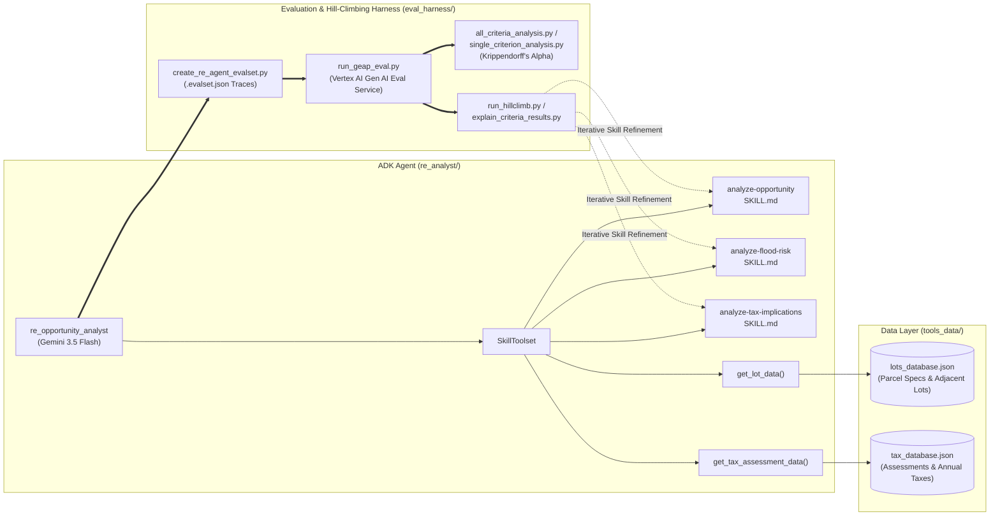

# Evaluating and Hill Climbing a Generative AI Agent using Autoraters (L400-APEX006)

End-to-end solution, evaluation harness, and hill-climbing implementation for evaluating and optimizing a **Real Estate Investment Opportunity Analysis Agent (`re_analyst`)** built with the **Google Agent Development Kit (ADK)** and evaluated using the **Gen AI Evaluation Service (GEAP)** on **Vertex AI / Gemini Enterprise Agent Platform**.

---

## Overview

Building production-ready AI agents requires rigorous, scalable evaluation to ensure consistent and reliable outputs. When human-annotated golden labels are unavailable during rapid prototyping, teams must:
1. **Generate Agent Traces**: Run the ADK agent across a benchmark dataset of vacant land lots (`eval_harness/hillclimb_lots.txt`) to record tool invocations and final investment reports.
2. **Evaluate with LLM-as-a-Judge**: Score generated reports against a 19-criterion domain rubric (`eval_harness/rubrics.json`) using Vertex AI's Gen AI Evaluation Service (`PointwiseMetric` + `EvalTask`).
3. **Analyze Autorater Self-Consistency (Intra-Rater Reliability)**: Execute multi-pass evaluations ($k=15$ passes across $N=32$ lots) and apply statistical reliability metrics (**Krippendorff's Alpha**, **Pairwise Percent Agreement**, **StdDev of Report Means**) while avoiding **homogeneity traps** and distractor metrics.
4. **Hill Climb Agent Skills**: Diagnose agent failure modes from autorater rationales and iteratively refine the agent's modular ADK skills (`SKILL.md`) until mean scores exceed `4.0` (achieving **5.0000 / 5.0000** on both target criteria).

---

## Architecture Diagram



---

## Repository Structure

```text
├── README.md                          # Project overview, architecture, and results summary
├── DESIGN_DOCUMENT.md                 # Detailed technical design document & statistical methodology
├── STEP_WISE_FLOW.md                  # Step-by-step execution guide and CLI commands
├── .env.example                       # Template environment configuration for Vertex AI
├── requirements.txt                   # Python 3.13 dependencies (google-adk, vertexai, krippendorff)
├── best_criteria_submission.txt       # Selected reliable rubric criteria (Task 5 deliverable)
├── re_analyst/                        # ADK Agent implementation
│   ├── agent.py                       # Root agent, SkillToolset, and system instructions
│   ├── skills/                        # Modular ADK agent skills (hill-climbed)
│   │   ├── analyze-opportunity/SKILL.md
│   │   ├── analyze-flood-risk/SKILL.md
│   │   └── analyze-tax-implications/SKILL.md
│   └── tools/                         # FunctionTools for county lot and tax lookups
│       ├── lot_tool.py
│       └── tax_tool.py
├── eval_harness/                      # Evaluation, reliability analysis, and hill-climbing suite
│   ├── rubrics.json                   # 19 evaluation criteria and 1-5 rating rubrics
│   ├── hillclimb_lots.txt             # 10 target property Lot IDs for hill climbing
│   ├── create_re_agent_evalset.py     # Concurrent ADK trace generator
│   ├── run_geap_eval.py               # Vertex AI EvalTask & PointwiseMetric runner
│   ├── metrics_calc.py                # Krippendorff's Alpha & pairwise agreement calculations
│   ├── single_criterion_analysis.py   # N x K matrix & margin statistics for a single criterion
│   ├── all_criteria_analysis.py       # Summary reliability table across all 19 criteria
│   ├── run_hillclimb.py               # Automated versioned hill-climbing loop
│   └── explain_criteria_results.py    # Judge rationale inspector for low-scoring lots
├── tools_data/                        # Mock county property & tax databases
│   ├── lots_database.json
│   └── tax_database.json
└── runs/                              # Evaluation outputs & versioned hill-climbing runs
    ├── baseline/
    ├── geap_calls_and_responses_for_analysis.json
    └── hillclimb_1/
```

---

## Key Results Summary

### 1. Reliable Autorater Criteria Selection (Task 5)
By evaluating $N=32$ property reports across $k=15$ passes in `runs/geap_calls_and_responses_for_analysis.json`, we filtered out criteria suffering from **top/bottom homogeneity traps** (where `sd_report_means` $\approx 0$ artificially inflates `%_agree` or sets degenerate $\alpha = 1.0$) and selected the three criteria exhibiting both high **Krippendorff's Alpha ($\alpha \ge 0.897$)** and strong discriminatory variance across reports (`sd_report_means > 0.33`):

| Criterion ID | Krippendorff's Alpha ($\alpha$) | Pairwise % Agreement | StdDev of Report Means (`sd_report_means`) | Widest Report Range |
| :--- | :---: | :---: | :---: | :---: |
| **`monthly-tax-holding`** | **0.997** | 99.17% | 0.8872 | 1 |
| **`flood-zone-flagging`** | **0.897** | 94.41% | 0.3357 | 1 |
| **`environmental-esa`** | **0.897** | 79.10% | 0.7042 | 3 |

Submission file (`best_criteria_submission.txt`):
```text
monthly-tax-holding,flood-zone-flagging,environmental-esa
```

### 2. Hill-Climbing Optimization Results (Task 6)
After enhancing the three skills in `re_analyst/skills/` to explicitly compute and benchmark **Acquisition Cost-Per-Acre** (`Last Sale Price / Acreage`) and exhaustively query all `adjacent_parcels` via `get_lot_data` for cross-boundary hydrological analysis, the agent achieved a **perfect 5.0000 mean score** on both target criteria:

| Target Criterion ID | Rubric Name | Target Mean Score | Achieved Mean Score (`hillclimb_1`) | Pass Rate (Score = 5.0) |
| :--- | :--- | :---: | :---: | :---: |
| **`cost-per-acre`** | Acquisition Cost-Per-Acre Calculation | `> 4.0` | **5.0000** | 10 / 10 Lots (100%) |
| **`neighboring-flood-risk`** | Neighboring Property Flood Risk Analysis | `> 4.0` | **5.0000** | 10 / 10 Lots (100%) |

---

## Documentation Links

- **[Design Document (`DESIGN_DOCUMENT.md`)](./DESIGN_DOCUMENT.md)**: Deep-dive into the system architecture, ADK `SkillToolset` design, Vertex AI GEAP integration, statistical theory of intra-rater agreement vs. homogeneity traps, and skill engineering.
- **[Step-Wise Flow (`STEP_WISE_FLOW.md`)](./STEP_WISE_FLOW.md)**: Step-by-step commands, workflows, and verification steps for reproducing the entire lab from environment setup to hill-climbing completion.
