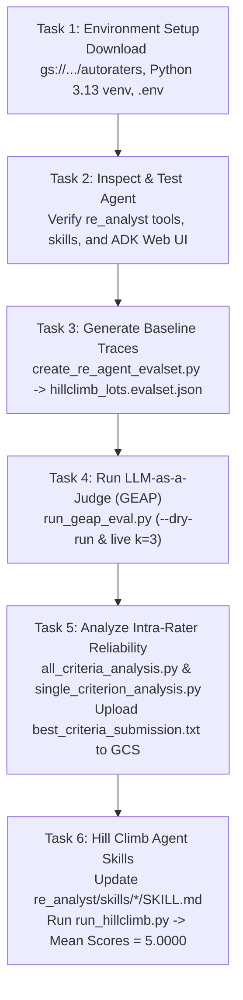

# Step-Wise Execution Flow (L400-APEX006)

This document provides the complete step-by-step execution flow to reproduce the **Evaluating and Hill Climbing a Generative AI Agent using Autoraters** lab from start to finish.

---

## Visual Workflow Overview



---

## Step 1: Set Up the Environment (Task 1)

### 1.1. Authenticate and Configure GCP Project
```bash
gcloud auth list
gcloud config set project qwiklabs-gcp-01-339a7b03a706
```

### 1.2. Download Lab Codebase from Cloud Storage
```bash
cd ~
gcloud storage cp -r gs://qwiklabs-gcp-01-339a7b03a706-bucket/autoraters .
cd ~/autoraters
```

### 1.3. Set Up Python 3.13 Virtual Environment and Install Dependencies
Note: `krippendorff-aleph-alpha==0.1.17` requires Python $\ge 3.13$. Using `uv` (or `pyenv`) installs Python 3.13 and all dependencies cleanly:
```bash
uv python install 3.13
uv venv --python 3.13 --seed .venv
.venv/bin/pip install -r requirements.txt
```

### 1.4. Create `.env` Configuration for `re_analyst`
```bash
cat << 'EOF' > ~/autoraters/.env
GOOGLE_GENAI_USE_VERTEXAI=TRUE
GOOGLE_CLOUD_PROJECT=qwiklabs-gcp-01-339a7b03a706
GOOGLE_CLOUD_LOCATION=global
MODEL=gemini-3.5-flash
EOF
```

---

## Step 2: Understand and Test the Agent (Task 2)

### 2.1. Inspect Agent Architecture
- **Root Agent**: `re_analyst/agent.py` defines `re_opportunity_analyst` using `gemini-3.5-flash` and a `SkillToolset`.
- **Tools**:
  - `re_analyst/tools/lot_tool.py` (`get_lot_data` reading `tools_data/lots_database.json`)
  - `re_analyst/tools/tax_tool.py` (`get_tax_assessment_data` reading `tools_data/tax_database.json`)
- **Skills**:
  - `re_analyst/skills/analyze-opportunity/SKILL.md`
  - `re_analyst/skills/analyze-flood-risk/SKILL.md`
  - `re_analyst/skills/analyze-tax-implications/SKILL.md`

### 2.2. Optional Interactive Testing via ADK Web UI
```bash
cd ~/autoraters
.venv/bin/adk web --allow_origins "regex:https://.*\.cloudshell\.dev"
```
Test prompt in the UI:
```text
Please evaluate investment suitability for lot LOT-8472 and generate a report.
```

---

## Step 3: Generate Agent Evaluation Traces (Task 3)

Run `eval_harness.create_re_agent_evalset` to execute `re_analyst` across the 10 target property IDs in `eval_harness/hillclimb_lots.txt` (`LOT-8472`, `LOT-8471`, `LOT-8473`, `LOT-1000`–`LOT-1006`) and save the ADK EvalSet JSON:

```bash
cd ~/autoraters
.venv/bin/python -m eval_harness.create_re_agent_evalset \
  --lots-file eval_harness/hillclimb_lots.txt \
  --out ./re_analyst/hillclimb_lots.evalset.json \
  --agent-dir ./re_analyst
```

---

## Step 4: Evaluate Agent Responses with LLM-as-a-Judge (Task 4)

### 4.1. Step 1 — Dry Run (Assemble & Inspect Prompts Locally)
```bash
cd ~/autoraters
.venv/bin/python -m eval_harness.run_geap_eval \
  --traces re_analyst/hillclimb_lots.evalset.json \
  --rubric-file eval_harness/rubrics.json \
  --out runs/baseline/geap_calls_and_responses.json \
  --experiment-name rubric-agreement-check \
  --dry-run \
  --k 3
```
This generates 190 records (`10 responses × 19 criteria`) with `prompt_made_to_service` and `"is_dry_run": true`.

### 4.2. Step 2 — Live Cloud Evaluation (Optional 3-Pass Run)
```bash
cd ~/autoraters
.venv/bin/python -m eval_harness.run_geap_eval \
  --traces re_analyst/hillclimb_lots.evalset.json \
  --rubric-file eval_harness/rubrics.json \
  --out runs/baseline/geap_calls_and_responses.json \
  --experiment-name rubric-agreement-check \
  --k 3
```

---

## Step 5: Analyze Autorater Intra-Rater Reliability (Task 5 — AT ID 1)

### 5.1. Inspect Single Criterion Rating Matrix ($N=32 \times k=15$)
```bash
cd ~/autoraters
.venv/bin/python -m eval_harness.single_criterion_analysis \
  --run_geap_eval_out runs/geap_calls_and_responses_for_analysis.json \
  --criterion environmental-esa
```

### 5.2. Compare Reliability Metrics Across All 19 Criteria
```bash
cd ~/autoraters
.venv/bin/python -m eval_harness.all_criteria_analysis \
  --run_geap_eval_out runs/geap_calls_and_responses_for_analysis.json
```

### 5.3. Select Reliable Criteria & Upload Submission to Cloud Storage
1. Exclude top/bottom homogeneity-trap criteria (`general-tone`, `logical-flow`, `professionalism`, `readability`, `neighboring-flood-risk`, `data-density`, `professional-tone`) where `sd_report_means` is `0.0000` or near-zero.
2. Select the top 3 criteria with high **Krippendorff's Alpha (`alpha`)** and meaningful cross-report variance (`sd_report_means`):
   - `monthly-tax-holding` ($\alpha = 0.997$, `sd_report_means = 0.8872`)
   - `flood-zone-flagging` ($\alpha = 0.897$, `sd_report_means = 0.3357`)
   - `environmental-esa` ($\alpha = 0.897$, `sd_report_means = 0.7042`)

```bash
cd ~/autoraters
echo "monthly-tax-holding,flood-zone-flagging,environmental-esa" > best_criteria_submission.txt
gcloud storage cp best_criteria_submission.txt gs://qwiklabs-gcp-01-339a7b03a706-bucket/best_criteria_submission.txt
```

---

## Step 6: Hill Climb Agent Skills to Raise Autorater Scores (Task 6 — AT ID 2)

### 6.1. Update the Agent's Skills (`re_analyst/skills/`)
1. **`re_analyst/skills/analyze-opportunity/SKILL.md`**:
   - Add `get_tax_assessment_data` to `adk_additional_tools`.
   - Instruct the agent to call `get_lot_data` for both the target parcel and **every lot ID listed in `adjacent_parcels`**.
   - Instruct the agent to explicitly compute and highlight `Acquisition Cost-Per-Acre = Last Sale Price / Acreage` as a core valuation metric in both the Executive Summary and Acquisition Basis sections, benchmarked against `Assessed Land Value Per Acre`.
2. **`re_analyst/skills/analyze-flood-risk/SKILL.md`**:
   - Add `get_lot_data` to `adk_additional_tools`.
   - Instruct the agent to query `get_lot_data` for all `adjacent_parcels`, build a comparative Markdown table of neighboring Lot IDs, FEMA flood zones, topography slopes, soil classifications, and easements, and critically analyze cross-boundary drainage, runoff, and shared hydrological impacts on the subject lot.
3. **`re_analyst/skills/analyze-tax-implications/SKILL.md`**:
   - Instruct the agent to explicitly calculate and present `Acquisition Cost-Per-Acre = Last Sale Price / Acreage`, `Assessed Land Value Per Acre = Assessed Land Value / Acreage`, and `Monthly Tax Holding Cost = Annual Tax Amount / 12`.

### 6.2. Run the Automated Hill-Climbing Harness
```bash
cd ~/autoraters
.venv/bin/python -m eval_harness.run_hillclimb
```
Expected Output:
```text
=========================================
📊 Hill Climbing Results: hillclimb_1
=========================================
 • cost-per-acre             Mean Score: 5.0000
 • neighboring-flood-risk    Mean Score: 5.0000
=========================================
```

### 6.3. Verify Detailed Per-Lot Scores & Explanations
```bash
cd ~/autoraters
.venv/bin/python -m eval_harness.explain_criteria_results \
  --run_geap_eval_out runs/hillclimb_1/geap_calls_and_responses_hillclimb_1.json \
  --criterion cost-per-acre \
  --max_score_to_show 4.0

.venv/bin/python -m eval_harness.explain_criteria_results \
  --run_geap_eval_out runs/hillclimb_1/geap_calls_and_responses_hillclimb_1.json \
  --criterion neighboring-flood-risk \
  --max_score_to_show 4.0
```
All 10 properties score `5.0` on both `cost-per-acre` and `neighboring-flood-risk`.
